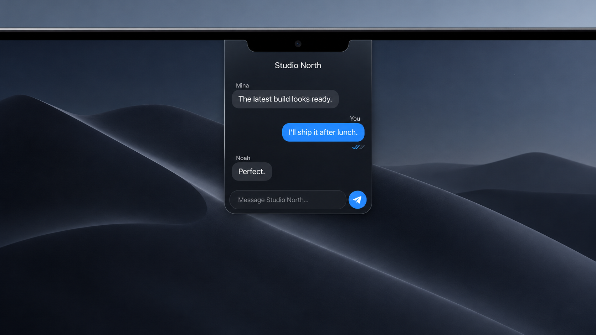

# NotchChat

NotchChat is a discreet, native Telegram client for the MacBook notch. Hover over the physical notch to open a compact conversation panel; move away or press `Esc` to hide it again.



> Demo image uses fictional messages and illustrates the current interface.

## Features

- Opens on hover and disappears completely into the physical MacBook notch.
- Connects to a real Telegram account through the official TDLib JSON interface.
- Supports phone-number login, Telegram login codes, email verification, and 2FA.
- Shows pinned chats first, followed by recent unpinned chats.
- Sends and receives text messages with live sent/read state.
- Displays Telegram photos and videos inside the notch panel.
- Runs as a menu-bar app and stays available across macOS Spaces.

## Requirements

- Apple Silicon Mac running macOS 14 or newer.
- Xcode 16 or newer, including Command Line Tools.
- [Homebrew](https://brew.sh/).
- A Telegram API ID and API hash from [my.telegram.org/apps](https://my.telegram.org/apps).

## Install

### 1. Clone the repository

```sh
git clone https://github.com/h-vien/notchapp.git
cd notchapp
```

### 2. Install build dependencies

```sh
brew install cmake openssl@3
xcode-select --install
```

If Command Line Tools are already installed, macOS will tell you and no action is needed.

### 3. Create Telegram API credentials

1. Sign in at [my.telegram.org](https://my.telegram.org/).
2. Open **API development tools**.
3. Create an application and copy its `api_id` and `api_hash`.
4. Create your local configuration:

```sh
cp .env.example .env
```

Edit `.env` and replace the example values:

```dotenv
TG_APIID=12345678
TG_APIHASH=0123456789abcdef0123456789abcdef
```

`TG_APIID` must contain digits only. `TG_APIHASH` must contain exactly 32 hexadecimal characters. These are application credentials—not your phone number, login code, bot token, or account password.

### 4. Build the app

```sh
sh scripts/build-app.sh
```

The first build compiles TDLib and can take several minutes. The resulting ad-hoc signed application is created at:

```text
build/NotchChat.app
```

### 5. Open NotchChat

```sh
open build/NotchChat.app
```

Optionally install it in Applications:

```sh
ditto build/NotchChat.app /Applications/NotchChat.app
open /Applications/NotchChat.app
```

## Connect Telegram

1. Hover over the physical MacBook notch.
2. Enter your phone number in international format, for example `+84…`.
3. Enter the login code sent by Telegram.
4. Complete email verification or enter your 2FA password if Telegram requests it.

The collapsed app is fully transparent and exactly covers the physical notch. Use the NotchChat icon in the macOS menu bar to quit the app.

## Configuration priority

NotchChat resolves Telegram API credentials in this order:

1. `TG_APIID` and `TG_APIHASH` process environment variables.
2. Values embedded from `.env` by `scripts/build-app.sh`.
3. Credentials entered in the authentication screen and stored in macOS Keychain.

The Telegram session database is stored at:

```text
~/Library/Application Support/NotchChat/Telegram
```

Login codes, email codes, and 2FA passwords are passed directly to TDLib and are not persisted by NotchChat. `.env` is ignored by Git. Like other TDLib desktop clients, the locally built application contains its Telegram application API ID and hash; do not publish a built bundle containing credentials you do not want to distribute.

## Troubleshooting

### `API_ID_INVALID`

- Confirm that `TG_APIID` is the numeric `api_id` from **API development tools**.
- Confirm that `TG_APIHASH` is the matching 32-character `api_hash`.
- Do not use a bot token or your phone number.
- Rebuild after changing `.env`:

```sh
sh scripts/build-app.sh
```

### The phone-number field cannot be focused

Open NotchChat from the menu bar or hover over the notch, then click the field after the panel has expanded. Make sure an older build is not still running.

### The new build does not appear

Quit NotchChat from its menu-bar icon, then reopen the newly built app:

```sh
open build/NotchChat.app
```

### TDLib or OpenSSL cannot be found

```sh
brew reinstall cmake openssl@3
sh scripts/build-app.sh
```

## Development

Run tests:

```sh
swift test
```

Build and verify the distributable bundle:

```sh
sh scripts/build-app.sh
codesign --verify --deep --strict --verbose=1 build/NotchChat.app
```

## Architecture

- `NotchPanelController` positions and animates the top-center `NSPanel`.
- `NotchPanelView` renders authentication, chats, messages, media, and the composer.
- `ChatService` defines the transport-neutral request/event boundary inspired by [nchat](https://github.com/d99kris/nchat).
- `TelegramChatService` maps requests and ordered updates to the TDLib JSON interface.
- `ChatStore` owns UI-facing chat and message state on the main actor.
- `vendor/nchat` contains the unmodified upstream reference source under its own licenses.

## Privacy notes

- The collapsed notch never displays sender names, message previews, or unread counts.
- Media is viewed inside NotchChat instead of being opened automatically in another application.
- The README demo uses fictional content and contains no Telegram account data.
